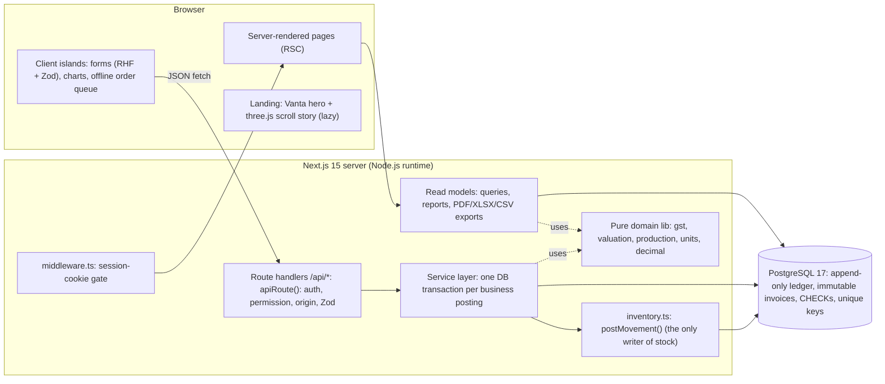
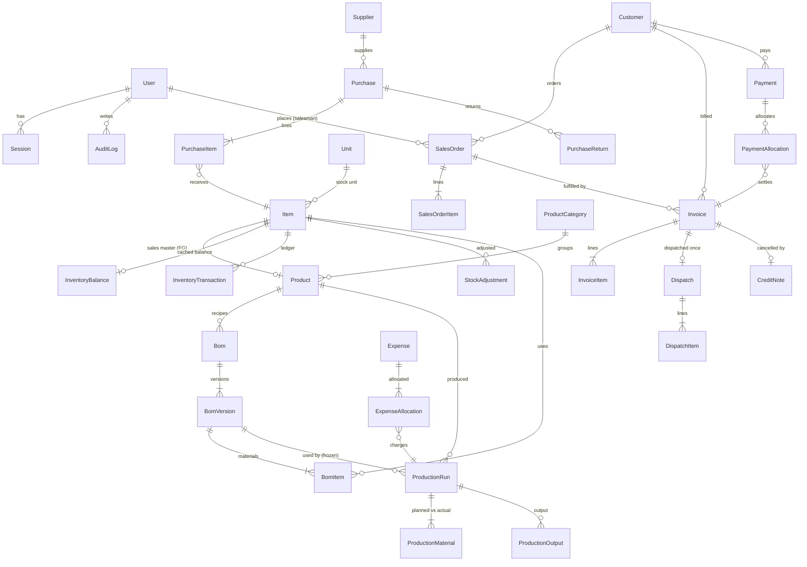

# Design note: Sutra ERP

This note explains how the system is built and why: the architecture, the data model, the inventory ledger, and the formulas behind BOM explosion, variance, costing and GST.

## 1. System architecture



Principles:

* **Single source of truth.** Every stock change is an `InventoryTransaction` row. Balances, valuations, dashboards and reports are derived from posted rows.
* **Thin transport, thick services.** Route handlers only authenticate, authorise, validate and call one service function. The seed and the integration tests call the same service functions, so the benchmark exercises production code.
* **Pure calculations** (`src/lib`) are deterministic and unit-tested, and are shared by the server, the UI previews and the tests.
* **Defence in depth.** Application checks give friendly errors. Database constraints and triggers back them up, so a bug or a manual SQL session cannot corrupt the books.

## 2. ER diagram



Supporting tables: `CompanySettings` (seller GSTIN, address, variance tolerance), `DocumentSequence` (financial-year numbering) and `AuditLog`.

## 3. Database design

| Topic | Decision |
|---|---|
| Stock items | One `Item` table for raw materials, packaging and finished goods (`kind`). `RawMaterial` and `PackagingMaterial` are `Item` rows with that kind, so the ledger, balances and BOM lines need just one foreign key. Finished goods have a 1:1 `Product` row for sales attributes (SKU, HSN, GST, price). |
| Units | `Unit(dimension, toBase)`: kg/g, L/mL, pcs/pkt. Purchases and BOM lines may use any unit of the same dimension; quantities are converted to the item's stock unit. |
| Precision | Money `Decimal(14,2)`, quantity `Decimal(14,3)`, unit cost `Decimal(18,6)`, ledger value `Decimal(16,4)`, BOM quantity `Decimal(14,4)`. JavaScript floats are never used for amounts; all arithmetic uses `decimal.js` with half-up rounding. |
| Numbering | `DocumentSequence` rows like `INV:2026-27`, incremented with `INSERT … ON CONFLICT DO UPDATE … RETURNING` inside the posting transaction: gap-free per committed transaction and concurrency-safe. Numbers are `INV/2026-27/0001` (FY April–March, IST). |
| Snapshots | Invoices copy the seller and buyer name, GSTIN, address, place of supply and line rates/HSN at posting. Runs copy the BOM version, tolerance, material rates and selling price. Later master-data changes never alter history. |
| Idempotency | `SalesOrder.clientRef` unique (offline sync), `Dispatch.invoiceId` unique (dispatch once), `CreditNote.invoiceId` unique, `Purchase(supplierId, supplierInvoiceNo)` unique, ledger key `(sourceType, sourceId, sourceLineId, movementType)` unique. |
| Integrity (SQL) | CHECKs: `InventoryBalance.quantity ≥ 0`, ledger `balanceAfter ≥ 0`, positive payments and allocations, `invoicedQty ≤ quantity`, `returnedQty ≤ stockQty`. Triggers: ledger rows can't be updated or deleted; invoices can't be deleted, and only `status`/`cancelledAt` may change (never back from CANCELLED); invoice lines are immutable. |
| Indexes | On every foreign key used in lists, plus `(itemId, txnDate)`, `txnDate`, `movementType`, `(sourceType, sourceId)` on the ledger, and date/status columns on documents. |

## 4. Inventory ledger architecture

`postMovement(tx, input)` in `src/server/inventory.ts` is the **only** code that changes stock:

1. Ensure a balance row exists (`INSERT … ON CONFLICT DO NOTHING`), then `SELECT … FOR UPDATE` it. This serialises concurrent postings for the same item.
2. Compute the valuation (`src/lib/valuation.ts`):
   * receipt (`qty > 0`): `valueChange = qty × rate` (rate = purchase/production cost, or the current average for returns);
   * issue (`qty < 0`): refuse if `|qty| > balance` (`InsufficientStockError`, 422), else `valueChange = −value × |qty| / balance` (or −value when issuing everything).
3. Append an `InventoryTransaction` with `balanceBefore/After`, `valueBefore/After`, `unitCost`, source document, line, batch, expiry, date and user.
4. Update the `InventoryBalance` cache (quantity, value, average cost, last transaction).

Multi-line postings lock balances in sorted item order (no deadlocks) and run `assertAvailable()` first, so all shortages are reported together. **Reconciliation** (`reconcileInventory`) compares each cached balance with `SUM(ledger.quantity)` and `SUM(ledger.value)`. It is shown on the Inventory page, included in the monthly audit report and asserted in the tests.

Movement types and their sources:

| Movement | Posted by | Sign |
|---|---|---|
| `OPENING_STOCK` | seed / opening | + |
| `PURCHASE_RECEIPT` | purchase line | + |
| `SUPPLIER_RETURN` | purchase return | − |
| `PRODUCTION_ISSUE` | run completion (raw materials) | − |
| `PACKAGING_CONSUMPTION` | run completion (packaging used) | − |
| `DAMAGED_MATERIAL` | run completion (damaged/wasted) or damage write-off | − |
| `PRODUCTION_OUTPUT` | run completion (good packets) | + |
| `SALES_DISPATCH` | dispatch of an invoice | − |
| `CUSTOMER_RETURN` | credit note with goods returned | + |
| `STOCK_ADJUSTMENT` | authorised count correction (Admin) | ± |

## 5. BOM calculation methodology

* A `BomVersion` defines **batch size** *B* (output units per batch, e.g. 200 packets), **expected yield %** *Y* (default 100) and lines (*item, quantity q, unit u*) per batch.
* Planned output for *n* batches: `P = B × n`. Expected good output: `E = P × Y / 100`.
* Standard requirement per line in the stock unit: `R = convert(q, u → stockUnit) × n`, where `convert(x) = x × u.toBase / stockUnit.toBase` (1500 g → 1.5 kg).
* Standard material cost per batch: `Σ R × rate`, using the current weighted average (live) and the rates snapshotted at activation (`BomItem.standardRate`, `BomVersion.standardMaterialCost`). Per packet = cost ÷ *E*.
* Versioning: only DRAFT versions are editable; activating a draft archives the previous ACTIVE version. `ProductionRun.bomVersionId` is fixed at planning time, and `ProductionMaterial.plannedQty` is exploded and stored then, so later recipe changes never alter a historical run.

## 6. Production variance formulas

For each material line, with total issued `A = used + damaged` and standard `R`:

```
consumption variance %  = (A − R) / R × 100            oil: (10.5 − 10) / 10 × 100 = +5.00 %
yield variance %        = (good − E) / E × 100          (188 − 200) / 200 × 100 = −6.00 %
actual yield %          = good / P × 100                188 / 200 × 100 = 94.00 %
flagged                 = |variance| > tolerance        tolerance = CompanySettings.varianceTolerancePct (default 3)
```

The tolerance in force is stored on the run, so changing the setting doesn't rewrite past flags. `hasVarianceAlert` is set when any material or the yield is flagged. In the benchmark this flags oil (+5%), yield (−6%) and cartons (−10%, fewer cartons because fewer packets). Pouches at −3% sit exactly on the tolerance and are not flagged (strictly greater).

## 7. Costing methodology

**Valuation:** moving weighted average per item (section 4).

**Run cost** (frozen at completion, `src/lib/production.ts → computeRunCosting`):

```
raw material cost  = Σ |ledger value| of PRODUCTION_ISSUE (+ DAMAGED_MATERIAL) rows for raw items
packaging cost     = Σ |ledger value| of PACKAGING_CONSUMPTION + DAMAGED_MATERIAL rows for packaging
labour             = Σ allocations with category LABOUR
energy             = Σ allocations with category GAS, ELECTRICITY or GAS_AND_POWER
other overheads    = Σ allocations with category OTHER_OVERHEAD
total cost         = raw + packaging + labour + energy + other
cost per packet    = total cost / good output                       (4 dp)
gross margin/unit  = selling price − cost per packet;  margin % = margin / price × 100
```

**Overhead allocation methods** (`ExpenseAllocation`):

* `DIRECT`: 100% to the chosen run (used for the benchmark: labour ₹1,200 + gas & power ₹600).
* `OUTPUT_QUANTITY`: a period expense is spread over all runs completed in the same IST month in proportion to good output. Each share is rounded to the paisa and the remainder goes to the largest run, so the shares always sum to the expense exactly.

**Snapshot rules.** Material and packaging cost is fixed at completion from the ledger values posted then, so later purchases at new prices cannot change it. Allocations made later update only the labour, energy and overhead lines and the derived totals (`refreshRunOverheads`).

**Finished-goods valuation.** The `PRODUCTION_OUTPUT` row is valued at the run's cost known at completion (materials, packaging and overheads already allocated) ÷ good output. Overheads recorded after completion are not retro-capitalised into stock that may already be partly sold. Profitability on the owner dashboard therefore uses the **full** cost per packet from the latest costing snapshot, while the stock ledger keeps the conservative cost.

## 8. GST calculation methodology

`src/lib/gst.ts`:

```
supply type     = INTRA_STATE if seller state code = place-of-supply state code, else INTER_STATE
per line        taxable = round2(qty × rate)
  intra-state   CGST = round2(taxable × (rate/2)/100),  SGST = round2(taxable × (rate/2)/100)
  inter-state   IGST = round2(taxable × rate/100)
invoice totals  = sums of line amounts;  grand total = round(taxable + tax, 0);  round-off = grand − (taxable + tax)
```

* Retailer A (TN, 33): 150 × ₹50 = ₹7,500 → CGST 2.5% ₹187.50 + SGST 2.5% ₹187.50 → **₹7,875**.
* Distributor B (KA, 29), if invoiced in full: 120 × ₹50 = ₹6,000 → IGST 5% **₹300** → ₹6,300. A partial invoice for the 88 available packets would be ₹4,400 + ₹220 IGST = ₹4,620 (covered by a test).
* Place of supply = the customer's state (goods delivered to the customer). GSTINs are validated by format, the GSTN mod-36 checksum and a state code that matches the customer's state.
* Invoices are FY-numbered, immutable, and cancelled only through a credit note that reverses the same tax amounts.

## 9. Transaction and audit strategy

Each of these runs inside **one** `prisma.$transaction` (all-or-nothing):

| Operation | What commits together |
|---|---|
| Post purchase | purchase + lines + one `PURCHASE_RECEIPT` per line + balance updates + audit |
| Complete production run | conditional status claim `IN_PROGRESS → COMPLETED` (prevents double completion), stock validation for every line, raw issues, packaging consumption, damaged material, FG output with batch/expiry, material variances, yield and costing snapshot, audit |
| Create invoice | order row lock, availability check (on hand − undispatched invoiced qty), invoice + lines + tax, order `invoicedQty` and status, audit |
| Dispatch | invoice row lock, "already dispatched?" check, dispatch + `SALES_DISPATCH` per line at weighted-average cost, audit |
| Cancel invoice | credit note, optional `CUSTOMER_RETURN`, invoice status, order quantities, audit |
| Record payment | row locks on the customer's open invoices, allocation validation (≤ balance, ≤ payment), receipt + allocations, audit |
| Expense | expense + allocations + run costing refresh + audit |

**Duplicate protection:** state transitions use conditional `updateMany` (`WHERE status = expected`), so a second completion, approval or dispatch gets a 409. Unique keys stop any second ledger row for the same document line, and order creation is idempotent on `clientRef`.

**Audit trail:** `AuditLog(user, action, entity, summary, data JSON, IP, timestamp)` is written by every service inside the same transaction, so there is no audit entry for a change that rolled back and no change without an audit entry. Sign-ins, failed sign-ins, sign-outs and report exports are logged too. The audit log is read-only in the application.

## 10. Security

* Passwords: scrypt (N=16384, r=8, p=1, 16-byte salt), compared in constant time. Login always runs a hash comparison so response time doesn't reveal whether an account exists. Failed attempts are throttled per IP and email.
* Sessions: 256-bit random token in an `httpOnly`, `SameSite=Lax` cookie (`Secure` in production). The database stores only `HMAC-SHA256(token, SESSION_SECRET)`. Sessions expire after 12 hours and are deleted on logout. Deactivated users are rejected.
* Authorisation: `requirePageUser(permission)` on pages and `apiRoute({ permission })` on every API handler, both driven by `ROLE_PERMISSIONS`.
* CSRF: SameSite cookies plus an `Origin` = `Host` check on every state-changing API call.
* Input: Zod schemas for every body. Prisma parameterises all queries, and the few raw SQL statements use tagged templates.
* Headers: `X-Content-Type-Options`, `X-Frame-Options: DENY`, `Referrer-Policy` and `Permissions-Policy`. `poweredByHeader` is off.
* The client never sees the database URL or secrets: every Prisma import is server-only (server components, route handlers, services).

## 11. Landing-page 3D layer

* **Vanta.js NET** (MIT) renders the hero background. It is loaded with dynamic `import()`, only when WebGL is available, motion is allowed and the device isn't low-power. It is destroyed when the hero leaves the viewport. Vanta's NET effect targets older three.js and references `THREE.VertexColors`, which modern three removed, so it receives a shim object `{ ...THREE, VertexColors: true }`.
* **Scroll story:** the scroll-position-to-camera technique popularised by Fireship's three.js scroll demo, re-implemented (no code copied). GSAP ScrollTrigger reports section progress (0–1), and the render loop eases the camera between six procedural stations (no external models). The canvas is sticky behind the step cards. Rendering stops when off-screen or when the tab is hidden, and the pixel ratio is capped at 1.75. Reduced motion or no WebGL shows a static, highlighted flow diagram instead.
* The 3D code lives in `src/components/landing` and is never imported by the ERP pages.
