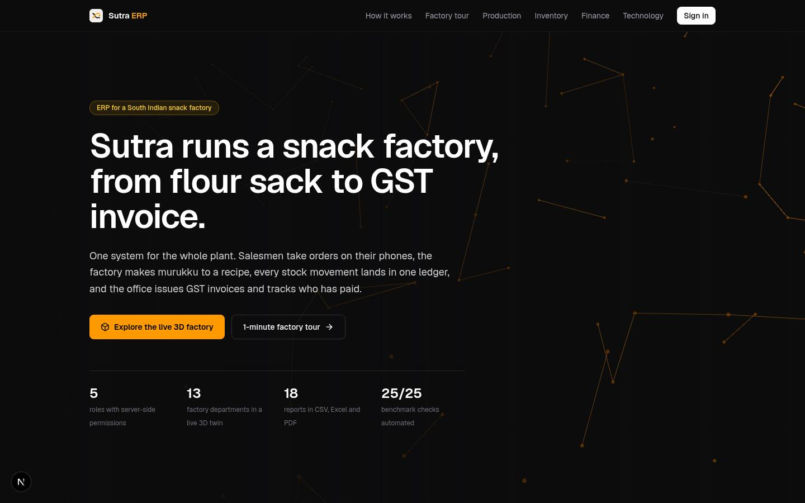
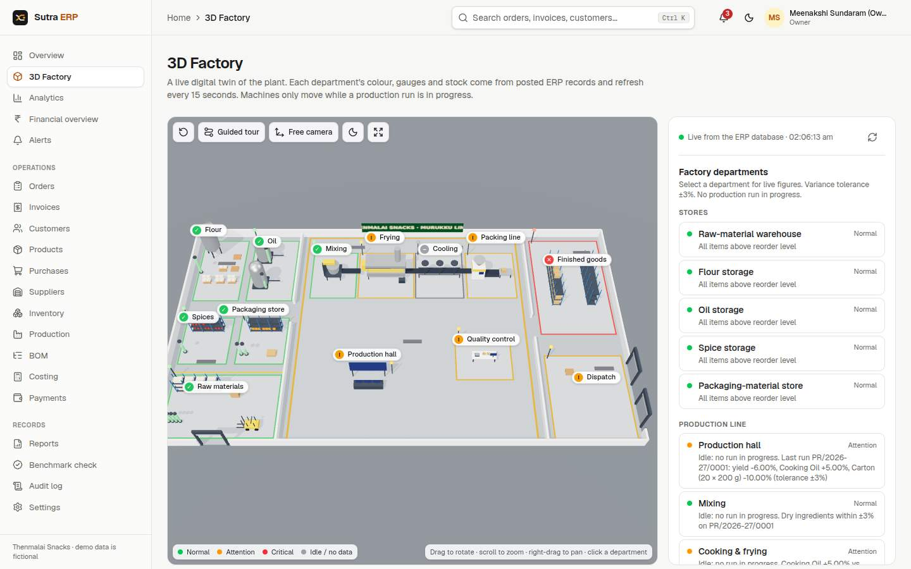
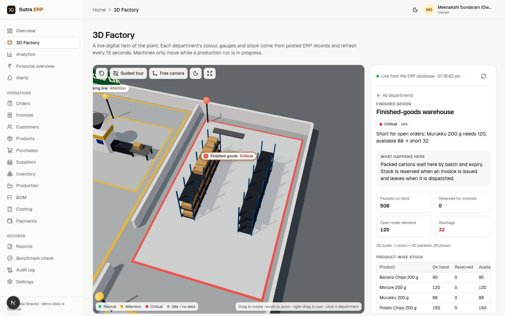
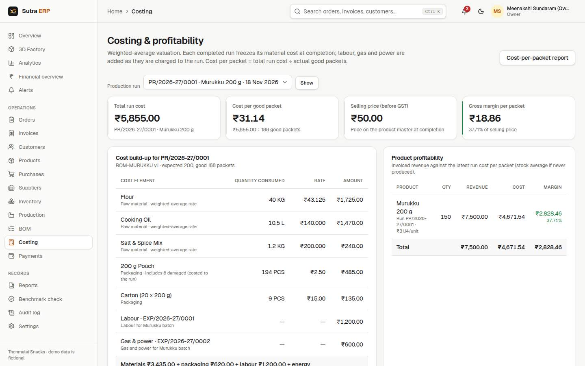
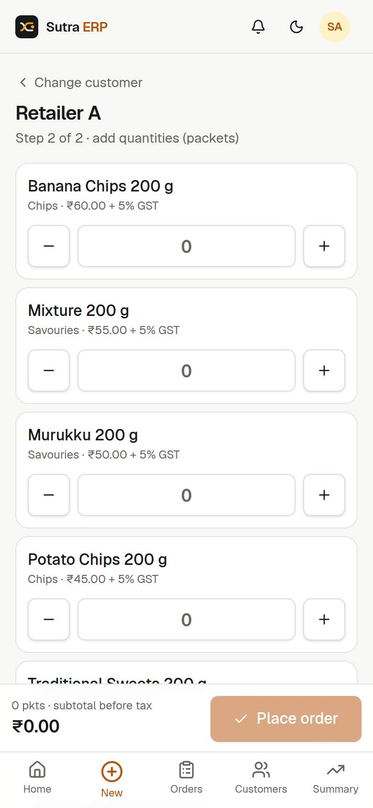
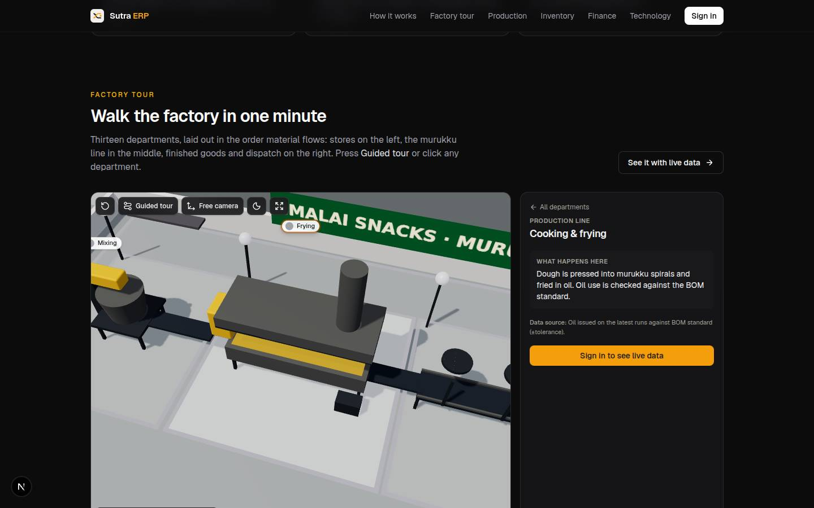
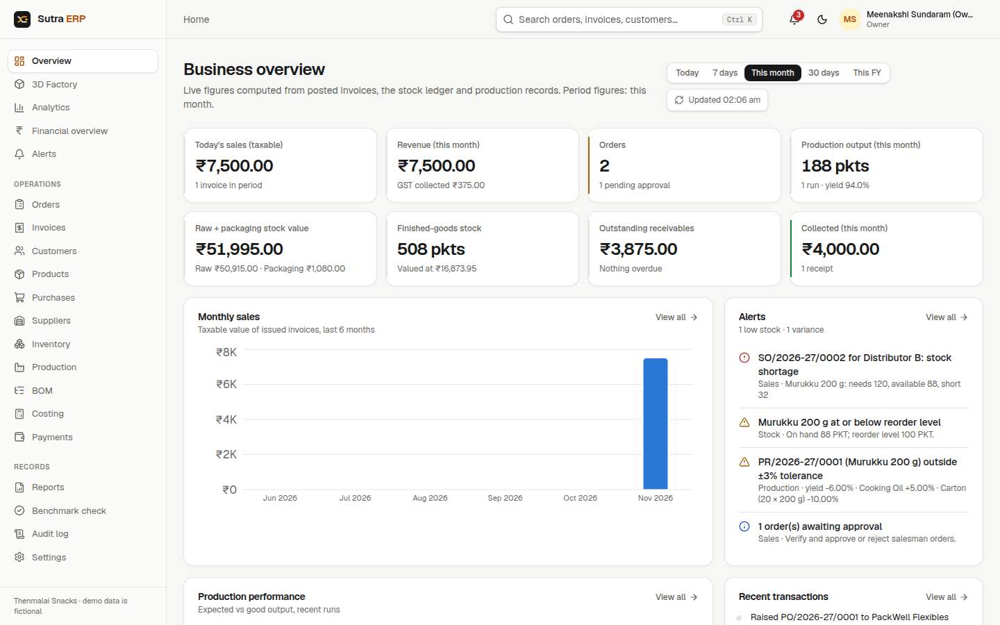
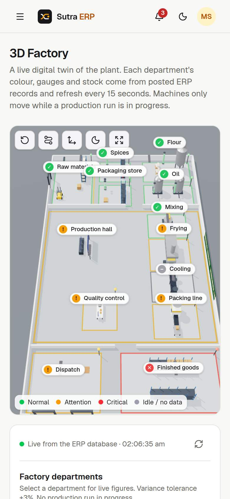

# Sutra Food Manufacturing ERP

**Live demo:** https://sutra-food-erp.vercel.app (sign in with any demo account below, password `Demo@1234`; all data is fictional)

**In 30 seconds:** Sutra runs a snack factory from flour sack to GST invoice. Salesmen book orders on their phones, the admin approves them against live stock, the factory makes murukku to a versioned recipe (BOM), every stock movement lands in one ledger, and the office issues GST invoices, records payments and pulls audit reports. A **live 3D digital twin** of the plant shows all 13 departments, coloured by what the database says is happening.

Sutra is built for a (fictional) South Indian packaged-snack manufacturer, *Thenmalai Snack Works Pvt. Ltd.*, which makes murukku, mixture, banana chips, potato chips and traditional sweets.

**The business problem.** A small snack maker typically runs on paper order books, a stock register and a separate billing tool. Nobody knows today's real flour or pouch stock, whether a distributor's order can be met, how much oil a batch really used, or what a packet actually costs. Sutra replaces that with one system of record where each transaction is entered once.

The core idea: **a transaction is entered once, at its source, and everything else updates from it.** Purchases, production runs, dispatches, returns and adjustments all post to a single, append-only **inventory ledger**. Stock balances, weighted-average costs, costing snapshots, GST invoices, receivables, dashboards and reports are all read from posted records. Nothing is hard-coded.

```
SALES       Salesman order → Admin verification → GST invoice → Dispatch → FG stock ↓ → Receivable → Payment
PRODUCTION  Purchase → Raw-material stock → BOM → Material issue → Run → Output → FG stock ↑ → Variance → Costing
                                   └──────────── one inventory ledger ────────────┘
```

> Internship evaluation project. All companies, people, GSTINs, phone numbers and addresses in the seed data are **fictional**. GST logic is a demonstration and is **not** a substitute for official GST filing, e-invoicing (IRN/QR) or certified government APIs.

---

## Contents

1. [Technology stack](#technology-stack)
2. [Architecture](#architecture)
3. [Features implemented](#features-implemented) and [features by role](#features-by-role)
4. [3D factory digital twin](#3d-factory-digital-twin)
5. [Screenshots](#screenshots)
6. [Installation and local run](#installation-and-local-run)
7. [Database setup](#database-setup)
8. [Environment configuration](#environment-configuration)
9. [Demo credentials](#demo-credentials)
10. [Seed and benchmark reset](#seed-and-benchmark-reset)
11. [Benchmark results](#benchmark-results)
12. [Costing assumptions](#costing-assumptions)
13. [Inventory valuation method](#inventory-valuation-method)
14. [Testing](#testing)
15. [Known limitations](#known-limitations)
16. [Deployment](#deployment) and [GitHub commands](#commit-push-and-deploy)
17. [Project structure](#project-structure)

Further documents: [DESIGN.md](DESIGN.md) (architecture, ER diagram, formulas, twin data flow), [BENCHMARK.md](BENCHMARK.md) (the mandatory scenario, step by step, expected vs actual), [DEMO_SCRIPT.md](DEMO_SCRIPT.md) (8-minute demo video script), [THIRD_PARTY_NOTICES.md](THIRD_PARTY_NOTICES.md).

---

## Technology stack

| Layer | Choice |
|---|---|
| Framework | Next.js 15 (App Router, React Server Components, Route Handlers), React 19, TypeScript 5 (strict) |
| UI | Tailwind CSS 4, shadcn/ui-style components on Radix primitives, Lucide icons, Recharts, Sonner toasts, next-themes (light/dark) |
| Forms & validation | React Hook Form + Zod (the same Zod schemas validate API input on the server) |
| Data | PostgreSQL 17, Prisma ORM 6, `decimal.js` for exact money/quantity arithmetic |
| Auth | Database-backed sessions (httpOnly cookie, HMAC-hashed token), scrypt password hashing, role-based permissions enforced on the server |
| Documents | PDFKit (GST invoices, report PDFs), ExcelJS (XLSX), CSV |
| 3D digital twin | Three.js (procedural models, OrbitControls, CSS2D labels, instanced meshes), GSAP camera moves, polling a database snapshot API; Vanta.js NET hero on the landing page |
| PWA | Web app manifest, service worker, offline order queue with idempotent sync |
| Tests | Vitest (unit + integration against a real PostgreSQL test database), HTTP smoke test |

## Architecture

```
Browser (server-rendered pages + small client islands)
   │  fetch (JSON, same-origin, session cookie)
   ▼
Route handlers  src/app/api/**          ← apiRoute(): auth, permission, origin check, Zod validation, error mapping
   │
Service layer   src/server/services/**  ← business rules; each posting is ONE prisma.$transaction
   │                 │
   │                 └── postMovement()  src/server/inventory.ts   ← the only code that changes stock
   ▼
PostgreSQL       append-only ledger (trigger), immutable invoices (trigger), CHECK constraints, unique keys

Server pages     src/app/(app)/**       ← read through src/server/queries/** and src/server/reports/**
Pure domain lib  src/lib/**             ← GST, WAC valuation, BOM explosion, variance, costing, units, twin status rules (unit-tested)
3D twin          src/components/factory ← Three.js scene; data from GET /api/factory → src/server/queries/factory.ts
```

**Stack in a few sentences.** Next.js 15 serves both the pages and the JSON API from one TypeScript codebase, so business rules live in one service layer that the API, the seed and the tests all call. PostgreSQL holds the data with Prisma as the typed ORM; money and quantities use exact decimals, and database constraints and triggers back up the application rules. The UI is Tailwind with Radix-based components and Recharts; the 3D factory is plain Three.js, lazy-loaded so it never slows the ERP screens.

* **Pure calculations** (`src/lib`) have no I/O. The same functions are used by the services, the UI previews and the tests.
* **Services** (`src/server/services`) own the workflows: purchases, BOM versioning, production, expenses, orders, invoices, dispatch, payments, adjustments and settings.
* **The benchmark scenario is executed through these services** (`prisma/seed/benchmark-scenario.ts`), so the seeded numbers come out of the real business logic.

See [DESIGN.md](DESIGN.md) for the ER diagram, the ledger posting algorithm, every formula and the digital-twin data flow.

## Features implemented

**Roles and access.** Five roles: Owner, Admin, Salesman, Production Supervisor and Accountant. Each has its own navigation and dashboard. Every page and every API route checks permissions on the server (`src/lib/permissions.ts`). Hidden buttons are cosmetic only.

**Owner.** Business overview with today's sales, monthly revenue, orders and pending approvals, production output and yield, raw/packaging stock value, finished-goods stock, low-stock alerts, variance alerts, receivables and collections, product-wise profitability, a monthly sales chart, production performance, an inventory-movement chart (stock value in vs out from the ledger) and recent transactions. A period selector (today, 7 days, this month, 30 days, this financial year) drives the period figures and profitability, and a refresh button re-reads the database. Also analytics (12 months), a financial overview, alerts, a live benchmark check and the audit log.

**Salesman (mobile-first).** Two-step order entry (customer, then quantities) with large tap targets and a sticky total. Captures an order in well under a minute. Also order history and status, customers, the product catalogue and a customer-wise sales summary. **Offline capture:** orders made offline are queued on the device with a UUID `clientRef` and synced automatically. The server treats `clientRef` as an idempotency key, so retries never create duplicates.

**Customers and products.** Retailers and distributors with GSTIN validation (format, checksum and state code), place of supply, credit limit, payment terms, live outstanding balance and an account statement. Products carry SKU, category, pack size, HSN, GST rate, selling price, reorder level, shelf life and active flag. Raw and packaging materials are managed alongside them.

**Purchase orders.** Raise a PO to a supplier (materials, quantity, unit, rate, GST, expected date). A PO is a commitment only and never moves stock. **Receive goods** against it later: the receipt form is pre-filled with the open balance, a part delivery leaves the PO `PARTIALLY_RECEIVED`, and receiving more than ordered is refused (also a database CHECK). Open POs show as incoming deliveries in the 3D raw-material warehouse.

**Purchases.** Supplier masters. Purchase entries post goods receipts with unit conversion (e.g. buy in grams, stock in kilograms), input GST, supplier batch and expiry. A duplicate supplier invoice is rejected. Supplier returns are supported. Every receipt is a ledger movement that updates the weighted-average cost.

**Bill of materials (versioned).** Draft → Active → Archived. Editing an active BOM creates a new draft version. Activation snapshots the weighted-average rates as the standard cost. Units are convertible per line (e.g. 1500 g of spice in a kg-stocked item). Each BOM shows standard material cost per batch and per packet, and the runs that used each version. **Runs keep their BOM version for ever.**

**Production.** Plan a run from the active BOM with a live preview of the required materials and stock. Record the issued quantities and start the run. Then record good output, damaged packaging, scrap and actual consumption, and complete. Completion is one atomic transaction. It deducts raw materials (`PRODUCTION_ISSUE`), packaging (`PACKAGING_CONSUMPTION`) and damaged material (`DAMAGED_MATERIAL`), adds finished goods (`PRODUCTION_OUTPUT`) with a batch number and expiry, computes yield and consumption variances against a configurable tolerance (default 3%), and freezes a costing snapshot. Variance analysis and material consumption screens include charts.

**Inventory.** Raw materials, packaging and finished goods. Ten movement types. Each ledger row records item, type, quantity, unit cost, value, balance before/after, source document, line, batch, expiry, date and user. Low-stock alerts, stock summaries, recent movements and a live **reconciliation** (balance cache = Σ ledger). Authorised adjustments require a reason and can never push stock below zero.

**Order verification (Admin).** Before invoicing, the admin can correct a line's quantity or agree a different rate. The change needs a reason and is stored in the audit log with every line's before and after values; once anything is invoiced the order is locked. The order page shows available stock, reserved stock, the shortage and the GST preview before approval.

**GST invoicing and dispatch.** FY-based numbering (`INV/2026-27/0001`). Seller and buyer snapshots are taken at posting. Intra-state supplies get CGST + SGST; inter-state supplies get IGST. Line-wise half-up rounding, a rupee round-off line and the amount in words. Downloadable PDF tax invoices. Invoices can only include stock that is actually available (partial fulfilment is supported). Each invoice is dispatched exactly once. Cancellation posts a **credit note** (optionally returning goods to stock); the database refuses edits or deletes on posted invoices.

**Payments and receivables.** Receipts can be auto-allocated oldest-first or manually across invoices. Allocations can never exceed an invoice's balance; any excess stays on account. Customer outstanding, open invoices and ageing buckets (not due, 1–30, 31–60, 61–90, 90+ days past due).

**Costing.** Weighted-average material cost at issue, packaging including damaged units, labour, gas and power, and other overheads. Overheads are charged directly to a run or spread over the month's runs by good output. The result is cost per good packet, gross margin and margin %, frozen per run. The **Costing** page shows each run's cost build-up line by line (₹5,855 ÷ 188 good packets = ₹31.14 for the benchmark run) and product profitability.

**Reports (accountant).** 18 reports: sales register, customer-wise and product-wise sales, GST outward supplies (HSN-wise) with credit notes, purchase register, raw/packaging/finished-goods stock, stock movement ledger, production, planned vs actual material, yield and wastage, cost per packet, collections, outstanding receivables, receivables ageing, audit trail, and a **consolidated monthly audit report** (summary, all registers, ledger reconciliation and audit trail). Filters cover date range, customer, product and transaction type. Every report exports to **CSV, Excel and PDF**, and every export is itself logged in the audit trail.

**Search and notifications.** The top bar searches orders, invoices, customers, products, purchase orders, production runs and suppliers (Ctrl K), limited on the server to what the role may see. The bell lists live alerts (low stock, variance, shortages, overdue invoices) for office roles and recent order decisions for salesmen.

**Audit and security.** Each posting writes an audit entry inside the same transaction. Passwords are hashed with scrypt. Session tokens are stored only as HMAC hashes and expire after 12 hours. Failed logins are rate-limited and audited. State-changing requests require a same-origin check. Inputs are validated with Zod. Security headers are set. No secrets reach the client.

**Landing page.** Built so a first-time visitor gets it fast: a one-sentence hero ("Sutra runs a snack factory, from flour sack to GST invoice"), a three-step *Sell → Make → Bill* strip, and a **1-minute factory tour** using the same 3D model as the live twin (click a department or press *Guided tour* for what happens there and which ERP records drive it). *Explore the live 3D factory* goes straight to sign-in and then to the live twin. The Vanta.js hero is lazy-loaded and skipped for reduced motion, missing WebGL or low-power devices.

## Features by role

| Role | Sees | Can do |
|---|---|---|
| **Salesman** (mobile-first) | Own orders and status, assigned customers, products and prices, customer-wise sales | Place orders in under a minute (also offline), cancel own pending orders |
| **Factory Admin** | Orders with stock check, customers, products, suppliers, POs, purchases, invoices, dispatch, payments, inventory, reports, 3D factory | Approve/reject/amend orders, issue GST invoices, dispatch, record payments, raise POs and receive goods, maintain masters, adjust stock, settings |
| **Production Supervisor** | Production dashboard, BOMs, runs, consumption, variance, costing, raw-material stock, POs, 3D factory | Create/activate BOM versions, plan → start → complete runs, record damage and scrap, charge labour/gas/power, raise POs and receive materials |
| **Accountant / Auditor** | Every register and report, stock ledger, costing, receivables, audit log, 3D factory | Read only; export any report to CSV, Excel or PDF |
| **Owner** | Business overview, analytics, finance, alerts, every record, costing and profitability, benchmark check, audit log, 3D factory | Read only (plus company settings) |

Permissions are enforced on the server for every page and API call (`src/lib/permissions.ts`); the integration tests call the real API routes as each role and expect 403 where the role has no right.

## 3D factory digital twin

`/factory` (Owner, Admin, Production Supervisor, Accountant) is an interactive 3D model of the plant with 13 clickable departments laid out in material-flow order: **stores** (raw-material warehouse, flour, oil, spice, packaging), the **murukku line** (production hall, mixing, cooking & frying, cooling, packaging line, quality control) and **finished goods** (warehouse, dispatch & loading).

* **Real data only.** `GET /api/factory` builds a snapshot from posted records and the page polls it every 15 seconds (and on window focus). Purchases raise the flour sacks and gauges, production lowers raw stock and adds cartons to the finished-goods racks, dispatch empties them, open invoices bring a truck to the dock, and variance colours the production line. Machines animate **only** while a run is `IN_PROGRESS`; otherwise the line says *Idle*. Cooling is not recorded separately in the ERP, and the twin says so.
* **Status:** green Normal, amber Attention, red Critical, grey Idle/no data, always with a text label and a shape glyph (✓ ! ✕ –), never colour alone. Rules are in `src/lib/factory.ts` and [DESIGN.md](DESIGN.md#11-3d-factory-digital-twin).
* **Info panel:** each department shows its status sentence, what happens there, live metrics, stock gauges, tables (recent ledger movements, open POs, runs, planned vs actual, batches, pending dispatches, orders awaiting stock) and links to the ERP pages that own the data.
* **Controls:** rotate, zoom, pan, reset camera, click-to-focus, a 13-step **guided tour**, free-camera mode (WASD/arrows, Q/E, +/−), day/night lighting, full screen. Labels are keyboard-focusable buttons.
* **Performance and fallbacks:** procedural geometry with shared materials and instancing, code-split and lazy-loaded (the page's first load is ~127 kB JS), rendering pauses off-screen, low-power devices drop shadows and pixel ratio, reduced motion disables animation, phones get a portrait framing, and without WebGL the same live data is shown as a department list.

The ERP never depends on the twin: every operation is available through normal forms, tables and dashboards.

## Screenshots

| | |
|---|---|
|  Landing page |  Live 3D factory twin |
|  Finished goods: shortage of 32 for Distributor B |  Costing: ₹5,855 ÷ 188 = ₹31.14 |
|  Salesman mobile order entry |  Landing-page factory tour |
|  Owner overview with period filter |  The twin on a phone (portrait framing) |

## Installation and local run

Prerequisites: **Node.js 20.19+** (tested with Node 24), **npm**, and **PostgreSQL 15+**. Docker Desktop is the easiest way to get PostgreSQL.

```bash
# 1. Install dependencies (also generates the Prisma client)
npm install

# 2. Configure the environment
cp .env.example .env          # Windows PowerShell: Copy-Item .env.example .env
#    edit .env: set POSTGRES_PASSWORD, the matching password in both URLs, and a random SESSION_SECRET

# 3. Start PostgreSQL (creates sutra_erp and the sutra_erp_test test database)
npm run db:up                 # = docker compose up -d db

# 4. Create the schema and load the benchmark scenario
npm run benchmark:reset       # prisma migrate reset --force → runs the seed

# 5. Run the app
npm run dev                   # http://localhost:3000
#   or the production build:
npm run build && npm start
```

Generate a session secret with `node -e "console.log(require('crypto').randomBytes(32).toString('hex'))"`.

> The service worker (offline order capture) registers only in the production build (`npm run build && npm start`).

## Database setup

* `docker-compose.yml` runs `postgres:17-alpine` on port 5432 with a named volume. On first start, `docker/init-test-db.sql` creates the separate `sutra_erp_test` database that the automated tests reset on every run.
* Migrations live in `prisma/migrations`:
  * `…_init`: tables, enums, foreign keys, unique keys and indexes.
  * `…_integrity_guards`: CHECK constraints (no negative stock, positive amounts, invoiced ≤ ordered, returned ≤ received), a trigger that makes `InventoryTransaction` **append-only**, and triggers that stop posted invoices and invoice lines from being edited or deleted.
* Using your own PostgreSQL instead of Docker: create the two databases, point `DATABASE_URL` and `TEST_DATABASE_URL` at them, then run `npm run db:migrate && npm run db:seed`.

## Environment configuration

| Variable | Purpose |
|---|---|
| `POSTGRES_USER`, `POSTGRES_PASSWORD`, `POSTGRES_DB`, `POSTGRES_PORT` | Used by `docker-compose.yml` |
| `DATABASE_URL` | Application database (Prisma) |
| `TEST_DATABASE_URL` | Test database. **Must differ** from `DATABASE_URL` and its name must contain `test`; the tests refuse to run otherwise |
| `SESSION_SECRET` | ≥ 32 random characters, used to HMAC session tokens |
| `SEED_DEMO_PASSWORD` | Password given to all demo accounts (default `Demo@1234`) |
| `COOKIE_SECURE` (optional) | `false` lets you sign in over plain HTTP from another device on your LAN when running `npm start`. Secure cookies are the production default |

`.env` is git-ignored. `.env.example` contains placeholders only.

## Demo credentials

All accounts use the password **`Demo@1234`** (fictional demo data). The login page has one-click buttons that fill these in.

| Role | Email | Lands on |
|---|---|---|
| Owner | `owner@sutra-erp.test` | Business overview |
| Admin | `admin@sutra-erp.test` | Orders, invoicing, dispatch, payments, purchases |
| Salesman A | `salesman.a@sutra-erp.test` | Mobile order app (Retailer A) |
| Salesman B | `salesman.b@sutra-erp.test` | Mobile order app (Distributor B) |
| Production Supervisor | `production@sutra-erp.test` | Production dashboard, BOM, runs |
| Accountant | `accounts@sutra-erp.test` | Read-only accounts and reports |

## Seed and benchmark reset

| Command | What it does |
|---|---|
| `npm run benchmark:reset` | Drops and recreates the schema, applies migrations and runs the seed. **Reproducible:** run it any time to get back to the exact benchmark state |
| `npm run db:seed` | Seeds an empty database (refuses to run twice) |
| `npm run benchmark:verify` | Prints the expected-vs-actual table from the current database and exits non-zero on any mismatch |
| `npm run demo:fresh` | Wipes the database and loads **only** master data and opening stock, so the scenario can be entered live in the UI (see [DEMO_SCRIPT.md](DEMO_SCRIPT.md)). After entering steps 1–10, the Benchmark check page shows 25/25 |
| `npm run demo:extras` | Adds the non-benchmark demo data (one open purchase order for packaging) to an already-seeded database. The seed runs it automatically; it never moves stock |
| `npm run factory:print` | Prints the live digital-twin status of every department from the current database |

The seed creates fictional master data (company, 6 users, 5 products, 12 materials, 3 suppliers, Retailer A in Tamil Nadu and Distributor B in Karnataka) and the opening stock. It then **replays the mandatory scenario through the service layer**: purchase, production run, orders, approval, invoice, dispatch, shortage check, payment and expenses. The in-app **Benchmark check** page (Owner, Admin, Accountant) shows the same comparison live.

## Benchmark results

All 25 checks pass (`npm run benchmark:verify`, the automated tests and the in-app page agree):

| Check | Expected | Actual |
|---|---|---|
| Flour closing stock | 120 kg | 120 kg |
| Oil closing stock | 19.5 L | 19.5 L |
| Spice mix closing stock | 3.8 kg | 3.8 kg |
| Pouches closing stock | 306 | 306 |
| Cartons closing stock | 21 | 21 |
| Finished goods after production | 238 | 238 |
| Finished goods after dispatch | 88 | 88 |
| Yield variance | −6% | −6.00% |
| Oil consumption variance | +5% | +5.00% |
| Weighted-average flour rate | ₹43.125/kg | ₹43.125/kg |
| Retailer A taxable amount | ₹7,500 | ₹7,500.00 |
| CGST / SGST | ₹187.50 each | ₹187.50 each |
| Invoice total | ₹7,875 | ₹7,875.00 |
| Retailer A outstanding | ₹3,875 | ₹3,875.00 |
| Distributor B shortage | 32 packets | 32 packets |
| Distributor B IGST if invoiced in full | ₹300 (5% of ₹6,000) | ₹300.00 |
| Flour / oil / spice / pouch / carton cost | ₹1,725 / 1,470 / 240 / 485 / 135 | same |
| Labour + gas & power | ₹1,800 | ₹1,800.00 |
| Total production cost | ₹5,855 | ₹5,855.00 |
| Cost per good packet | ≈ ₹31.14 | ₹31.14 (31.1436) |

Step-by-step ledger evidence: [BENCHMARK.md](BENCHMARK.md).

**How to run the benchmark:** `npm run benchmark:reset` rebuilds the database and replays the scenario (it prints the 25-row check table), `npm run benchmark:verify` re-checks the current database, `npm run test:benchmark` replays it on the test database with assertions, and the in-app **Benchmark check** page shows the same table live.

## Costing assumptions

* **Materials are costed at actual consumption, at the weighted-average rate at the moment of issue.** Flour: (100 × ₹42 + 60 × ₹45) / 160 = ₹43.125/kg, so 40 kg = ₹1,725.
* **Why 194 pouches:** each of the 188 good packets uses one pouch, and 6 pouches were damaged on the packing line. Both are deducted from stock. Good ones post as `PACKAGING_CONSUMPTION`, damaged ones as `DAMAGED_MATERIAL`, and all 194 are costed (194 × ₹2.50 = ₹485). The cost of damaged pouches is carried by the good packets. The other 6 of the 200 pouches issued were not used and are never deducted, so they effectively return to stores.
* **Why 9 cartons:** a carton holds 20 packets (BOM: 10 cartons per 200 packets). 188 packets fill 9 complete cartons (180 packets), and the remaining 8 packets go into a part-filled carton that is completed with the next run's output, so no 10th carton is consumed. The supervisor records the actual count (9); the system never infers it. The "fill packaging from good output" helper uses the same full-carton rule (⌊188 ÷ 20⌋ = 9).
* **Yield loss:** the 12 packets short of the 200-packet standard are process loss (broken or undersized pieces). Raw materials are charged in full, so the loss raises the cost per good packet.
* **Overheads:** labour ₹1,200 and gas & power ₹600 were recorded as expenses charged **directly** to the run. Period expenses can instead be allocated across the month's completed runs **in proportion to good output** (paisa remainder to the largest run).
* **Snapshot rule:** material and packaging cost is frozen when the run completes. Later purchases at new prices never change it (an automated test buys flour at ₹60 and checks the run still costs ₹5,855). Expenses added after completion update only the labour, energy and overhead lines.
* **Total:** ₹1,725 + ₹1,470 + ₹240 + ₹485 + ₹135 + ₹1,200 + ₹600 = **₹5,855**; ₹5,855 ÷ 188 = **₹31.1436 ≈ ₹31.14** per good packet. At ₹50 selling price the margin is ₹18.86 per packet (37.71%).

## Inventory valuation method

**Moving weighted average**, per item, maintained by the ledger:

* Receipt: `newValue = value + qty × rate`; `avg = newValue / newQty`.
* Issue: valued at the current average. To avoid rounding drift the issue value is `value × issueQty / balanceQty`, and issuing the whole balance takes the whole value.
* Money is `Decimal(14,2)`, quantities `Decimal(14,3)`, rates `Decimal(18,6)`, ledger values `Decimal(16,4)`. **No floating-point arithmetic is used for money or stock.**
* Finished goods are received at the run's cost known at completion (materials, packaging and any overheads already allocated). Opening finished-goods stock is valued at a fictional ₹30.00/packet.

## Testing

| Command | Scope |
|---|---|
| `npm test` | Everything below except the smoke test: **68 tests** |
| `npm run test:unit` | 34 unit tests: decimals, Indian number formatting, GST (CGST/SGST, IGST, rounding, words), GSTIN checksum, unit conversions, weighted average, BOM explosion, variances, costing, overhead allocation, FY numbering, the role permission matrix, navigation-vs-permission consistency and the digital-twin status rules |
| `npm run test:benchmark` | 34 integration tests on a real PostgreSQL test DB. `benchmark.test.ts` (22): resets it, seeds, replays the scenario through the services and asserts every benchmark figure, ledger reconciliation, frozen historical cost, duplicate completion and dispatch, idempotent offline sync, payment over-allocation, negative stock, DB-level immutability, the Distributor B shortage and partial IGST invoice, and credit-note cancellation. `workflows.test.ts` (12): the twin snapshot matches the benchmark and changes after a posting; PO → partial receipt → over-receipt refused → received; admin order amendment with before/after audit; stock adjustment; partial payment; real API routes as each role (401/403/200) |
| `npm run test:smoke` | 203 HTTP checks against a running server (`npm run build && npm start`; set `BASE_URL` for another host): every navigation page per role including the 3D factory, costing and purchase orders, permission denials, twin/search/notification/PO/amend API permissions, CSRF/origin blocking, validation, the sales workflow, and all 18 reports in CSV/XLSX/PDF. It changes data, so run `npm run benchmark:reset` afterwards |
| `npm run typecheck`, `npm run lint` | TypeScript strict and ESLint (zero warnings) |

Results at delivery (18 Nov 2026): **68/68 Vitest tests**, **203/203 smoke checks** against the production build, 25/25 benchmark checks, clean typecheck, lint (zero warnings) and production build. The UI forms were also driven end to end in headless Microsoft Edge (login, mobile order entry, approve → invoice → dispatch, payment, purchase, customer, settings, BOM new version + activation, production plan → start → complete, expense) with no console errors or horizontal overflow at 390 px. In this round the new flows (mobile order → admin edit and approval, purchase-order goods receipt, the 3D twin's department selection, list, tour and reset) were driven in headless Chromium while recording the demo video, and the landing page, twin, costing and dashboard were checked at 1440 px and 390 px with no console errors.

## Known limitations

These are deliberate scope limits for a prototype, stated plainly:

* **GST:** demonstration only. No e-invoice IRN/QR, e-way bill, GSTR returns, reverse charge or TCS/TDS. One GST rate per product. The seller and the buyer's state come from master data.
* **Offline mode** covers salesman order capture only. The device must have opened the order screen online once (to cache the page and catalogue). The queue lives in `localStorage`, so clearing browser data before syncing loses it. The service worker runs only in production builds.
* **Production reservations:** stock is validated when a run starts and again atomically at completion, but it is not reserved in between. A competing run can consume it, and completion then fails with a clear shortage message.
* **Batch/expiry:** batch numbers and expiry dates are recorded on receipts and production output, and expiry alerts are raised, but consumption is not tracked per batch (no FEFO picking).
* **Overheads recorded after a run completes** update its costing snapshot but are not re-capitalised into finished goods that may already be partly sold. Stock valuation therefore excludes them (documented in DESIGN.md).
* **Invoice cancellation** is blocked once a payment is allocated to the invoice. A payment-reversal workflow is not implemented.
* **Purchase orders** have no approval step (a PO raised by the admin or supervisor is effective at once) and no supplier-facing PDF. Supplier returns are valued at the current weighted average.
* **Order amendment** is allowed only before invoicing; after that the route is cancel-with-credit-note and re-invoice.
* **Users and roles** are seeded. There is no user-administration UI, and roles are fixed in code.
* Login rate limiting is in-memory (one server instance). Use a shared store if you scale out.
* PDF documents use the standard PDF fonts, which lack the ₹ glyph, so PDFs show "INR" or "Rs." (screens, CSV and Excel use ₹).
* One company, one factory, INR only, IST business dates.
* **3D digital twin:** a schematic procedural model, not a CAD/BIM model of a real building. It refreshes by polling every 15 s rather than push. Cooling, mixing and frying are not separate ERP transactions, so they reflect the run in progress and the latest completed run's material variances. Without WebGL the twin is shown as a list.
* Not load-tested. Reports run synchronously (the audit trail report is capped at 2,000 rows).

## Deployment

The app is a standard Next.js Node server plus PostgreSQL.

1. Create a managed PostgreSQL database (e.g. Neon, Supabase, AWS RDS, Azure Database for PostgreSQL).
2. Set the environment variables `DATABASE_URL` and `SESSION_SECRET` (plus `SEED_DEMO_PASSWORD` if you seed demo data). `TEST_DATABASE_URL` is only needed where tests run.
3. Build and migrate:
   ```bash
   npm ci
   npx prisma migrate deploy
   npm run build
   npm start            # serves on PORT (default 3000)
   ```
4. Optional demo data: `npx prisma db seed` (on an empty database only).

**Vercel:** `vercel.json` already sets the build command (`prisma migrate deploy && prisma db seed && next build`; the seed loads the demo data on the first deploy and skips afterwards) and the Singapore region; only `DATABASE_URL`, `SESSION_SECRET` and `SEED_DEMO_PASSWORD` need to be added as environment variables. Use a direct (non-pooled) connection string for Neon. PDFKit and ExcelJS are configured as server-external packages and run in the Node.js runtime (already declared on the export routes). **Docker / VM:** run the commands above behind a reverse proxy with HTTPS. Secure cookies are on by default in production. Do not deploy with the demo accounts enabled for real data.

## Project structure

```
prisma/
  schema.prisma                 data model (36 models)
  migrations/                   SQL migrations incl. integrity triggers
  seed.ts, seed/                fictional master data + benchmark scenario (runs through services)
src/
  app/
    page.tsx                    public landing page (hero, Sell → Make → Bill, 3D factory tour)
    login/                      sign-in
    (app)/                      authenticated pages (dashboard, factory, orders, invoices, purchase-orders, production, bom, costing, reports, …)
    api/                        route handlers (one per command)
  components/
    ui/                         shadcn-style primitives
    app/, forms/, charts/       shell, widgets, React Hook Form forms, Recharts wrappers
    factory/                    3D digital twin: factory-scene.ts (Three.js), factory-props.ts (procedural machines), factory-twin.tsx (UI)
    landing/                    Vanta hero, intro animation, WebGL/motion capability checks
  lib/                          pure domain logic (decimal, gst, gstin, units, valuation, production, permissions, validation, factory status rules)
  server/
    services/                   business workflows (transactions)
    inventory.ts                ledger posting + reconciliation
    queries/, reports/, pdf/    read models (incl. factory.ts twin snapshot), report engine + exports, PDF rendering
    auth/                       sessions, password hashing
tests/                          unit + integration (Vitest)
scripts/                        benchmark verify, twin print, demo extras, HTTP smoke test, icon generator
docs/screenshots/               README screenshots
demo/                           demo video narration, subtitles and recording script
public/                         manifest, service worker, icons
```

## Commit, push and deploy

Nothing in this round has been committed, pushed or deployed. To publish it yourself:

```bash
# review and commit
git status
git add -A
git commit -m "Add 3D factory digital twin, purchase orders, order amendment, costing page, search and notifications"

# push (this repo's remotes: origin and nitt-assignment)
git push origin main
git push nitt-assignment main      # if you also publish to the NITT-Assignment repository

# deploy to Vercel (the project is not connected to GitHub, so deploy from the CLI)
npx vercel --prod
```

The Vercel build runs `prisma migrate deploy` first, so the new `purchase_orders` migration is applied to the Neon database automatically; the seed is skipped on an already-seeded database (run `npm run demo:extras` against Neon if you want the demo purchase order there too).

